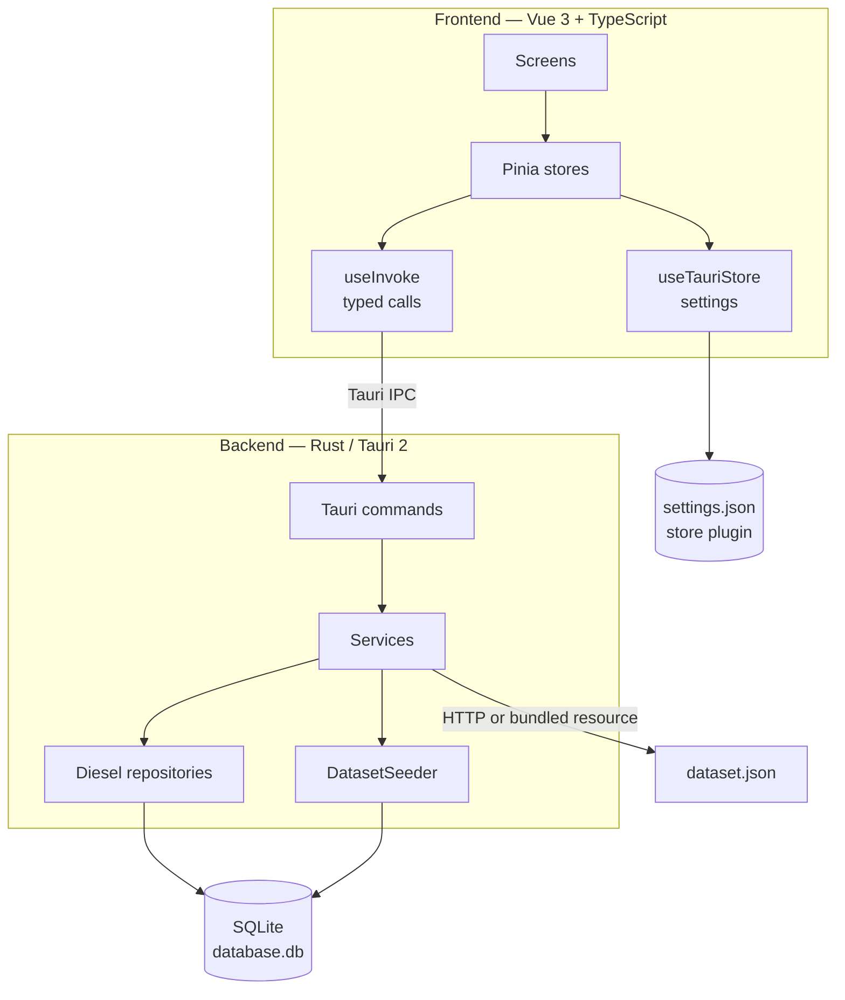
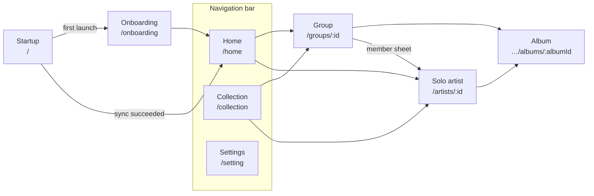
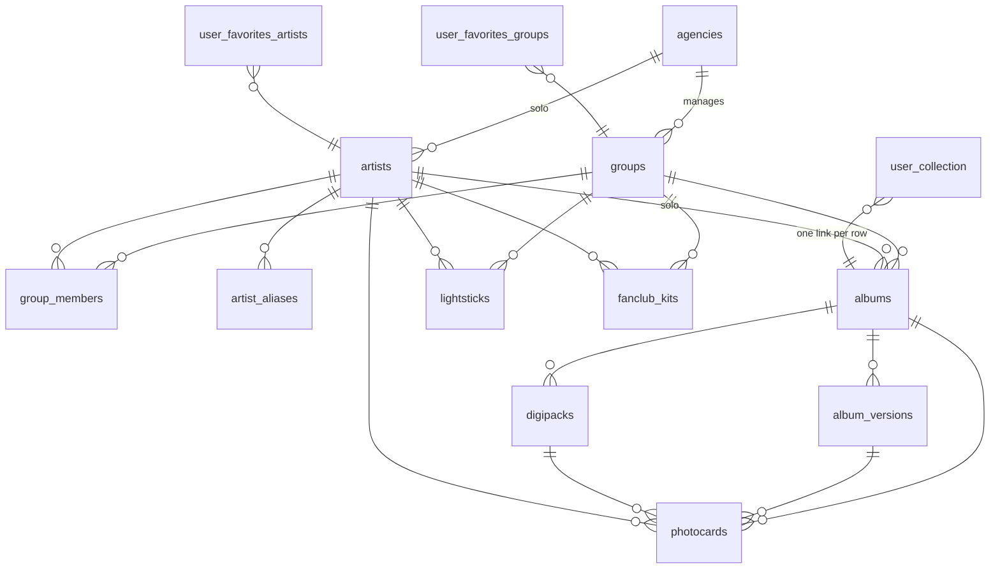

# The app today

State of the application when these docs were written (version `0.1.0`). This document describes what **exists**; the [specs](../specs/) describe what **changes**.

Kolect is a mobile-first app (Android first, desktop for development) for tracking a collection of K-pop items: albums, album versions, digipacks, photocards, lightsticks and fanclub kits.

## Big picture



| Layer | Technologies |
| --- | --- |
| Frontend | Vue 3, TypeScript, Vite, Pinia, Vue Router, vue-i18n, VueUse, Tailwind CSS 4, DaisyUI 5, Lucide |
| Backend | Rust, Tauri 2, Diesel (embedded SQLite), reqwest, tokio |
| Tauri plugins | `fs`, `store`, `log`, `os`, `opener` |
| Tooling | Bun, Biome, Vitest, Lefthook, GitHub Actions |

Everything runs locally on the device. The only network access is the catalog download.

## Features

### Navigation



### Per screen

| Screen | What the user can do |
| --- | --- |
| **Startup** | Sees the logo while the catalog syncs. On failure: error message, Retry button, button to go to Home anyway |
| **Onboarding** | 5 steps, first launch only: welcome, language (detected from the system), theme, content preferences, confirmation. Can be skipped |
| **Home** | Browses **the whole catalog**: groups and solo artists mixed, favorites first then alphabetical. Search by name, filter by agency, infinite scroll (6 per page). Each card shows owned items out of the total |
| **Collection** | Same list, limited to groups and artists the user **owns at least one item of**. The agency filter only lists agencies present in the collection |
| **Group** | Albums, lightsticks and fanclub kits of the group. All / Owned / Missing filter. Add or remove from favorites. Member list, with access to a member's solo page |
| **Solo artist** | Same as the Group screen, for a solo artist |
| **Album** | Versions, digipacks and photocards of the album, with the same ownership filter |
| **Settings** | Theme, language, manual catalog sync (long press = forced sync), content preferences, app version |

### Ownership

From any item card, a modal lets the user set:

- the **number of copies owned** (duplicates are allowed);
- the **number of signed copies**, which cannot exceed the number owned.

Six item types are collectible: album, album version, digipack, lightstick, fanclub kit, photocard.

### Settings

| Setting | Values | Effect |
| --- | --- | --- |
| Theme | System, Light, Dark | Appearance |
| Language | French, English | Interface |
| Include exclusive items | Yes / No (default: no) | When off, only items with region `GLOBAL` are shown and counted |
| Include photocards in counts | Yes / No (default: no) | Counts photocards or not in owned / total figures |
| Onboarding done | Internal | Prevents replaying the onboarding |

They are stored in `settings.json` by the `store` plugin, not in the SQLite database.

## Backend

### Layout

```
src-tauri/src/
├── commands/        Entry points called by the frontend
├── services/        Business logic
├── db/
│   ├── models/        Diesel structs
│   ├── repositories/  SQL queries
│   ├── schema.rs      Schema generated by Diesel
│   └── seeder.rs      Catalog import
├── dto/             Input (commands, dataset) and output structs
├── config.rs        Loads config/{dev,prod}.json
└── lib.rs           Startup, shared state, command registration
```

The shared state (`AppStore`) holds a **single SQLite connection** behind a mutex: commands run one at a time.

At startup: the database file is created if needed, embedded Diesel migrations are applied, the config is loaded.

### Tauri commands

| Domain | Command | Purpose |
| --- | --- | --- |
| Catalog | `dataset_sync` | Downloads the dataset and runs the seeder if the version is newer (or if `force`) |
| | `dataset_get_summary` | Paginated list of the catalog's groups and artists, with search and agency filter |
| | `dataset_get_agencies` | Agencies of the catalog |
| Collection | `collection_get_summary` | Same list, limited to what the user owns |
| | `collection_get_agencies` | Agencies present in the collection |
| | `collection_update_item` | Sets the number of owned and signed copies of an item |
| Group | `group_get_detail` | Group + members with their aliases |
| | `group_get_album_summaries` | Albums of the group with progress |
| | `group_get_lightsticks`, `group_get_fanclub_kits` | Items of the group with ownership |
| Artist | `artist_get_detail`, `artist_get_album_summaries`, `artist_get_lightsticks`, `artist_get_fanclub_kits` | Same for a solo artist |
| Album | `album_get_detail` | Album with versions / digipacks / photocards progress |
| | `album_get_versions`, `album_get_digipacks`, `album_get_photocards` | Album content with ownership |
| Favorites | `favorite_toggle_group`, `favorite_toggle_artist` | Toggles a favorite, returns the new state |

On the frontend, `useInvoke` wraps each command with per-name typing, a `loading` / `error` state and logging.

### Notable business rules

- **Ownership**: one `user_collection` row per copy. To go from N to M copies, the service adds rows or removes the most recent ones, then marks the first ones as signed.
- **Favorites first**: the list merges groups and artists in memory, sorts, then paginates.
- **Soft delete**: an entry removed from the catalog is flagged `is_deleted` instead of being deleted, so an owned item does not disappear.
- **Region**: every item has a region; `GLOBAL` means a non-exclusive edition.

## Data

### Model



`user_collection` also references `album_versions`, `digipacks`, `lightsticks`, `fanclub_kits` and `photocards`: each row points to **exactly one** item.

| Family | Tables | Origin |
| --- | --- | --- |
| Catalog | `agencies`, `groups`, `artists`, `artist_aliases`, `group_members`, `albums`, `album_versions`, `digipacks`, `lightsticks`, `fanclub_kits`, `photocards` | Imported from the dataset |
| User | `user_collection`, `user_favorites_groups`, `user_favorites_artists` | Created on the device |

Identifiers: UUID v4 stored as text. Dates: ISO text `YYYY-MM-DD`.

### On-device storage

| File (app data directory) | Content |
| --- | --- |
| `database.db` | SQLite: catalog + user data |
| `dataset_metadata.json` | Version of the last imported dataset |
| `settings.json` | Settings |

### Catalog

A single `public/dataset.json` file with a semver version, validated by a JSON schema and a Vitest test. Source per environment:

| Environment | Source |
| --- | --- |
| desktop dev | `http://localhost:1420/dataset.json` (served by Vite) |
| Android dev | File bundled in the app |
| prod | `raw.githubusercontent.com`, `main` branch |

Image URLs in the dataset currently point to a placeholder domain: no real image is hosted.

## Continuous integration

| Workflow | Purpose |
| --- | --- |
| `quality.yml` | Format and lint, frontend and backend |
| `audit.yml` | Dependency audit |
| `build.yml` | Frontend, backend and Android builds |
| `dataset-tests.yml` | Dataset validation |
| `release.yml` | Version bump, signed Android build (APK + AAB), GitHub release |

## Limits and things to fix

Found while reading the code; not all of them are addressed by the redesign.

| Item | Detail | Addressed by |
| --- | --- | --- |
| Blocking sync at startup | Without network, the user lands on an error screen | [specs/04](../specs/04-app-sync.md) |
| Whole catalog re-downloaded at every startup | No lightweight version check | [specs/03](../specs/03-catalog-export.md), [specs/04](../specs/04-app-sync.md) |
| Different download paths on Android and desktop | Two implementations of `download` | [specs/04](../specs/04-app-sync.md) |
| "+" button on the Collection screen | Links to `/collection/add`, a route that does not exist | `todo.md` (manual entry) |
| In-memory pagination | The whole list is loaded, then sliced | [specs/06](../specs/06-database-schema.md) |
| Images | No real hosting | [decisions/0010](../decisions/0010-relative-image-keys.md) |
| Stale paths | `package.json`, `diesel.toml` and `dataset-tests.yml` reference `src/infrastructure/db/…` while the schema lives in `src/db/` | To fix in phase 1 |
| Migration scripts | The database path in `package.json` is the Linux one | To fix in phase 1 |
