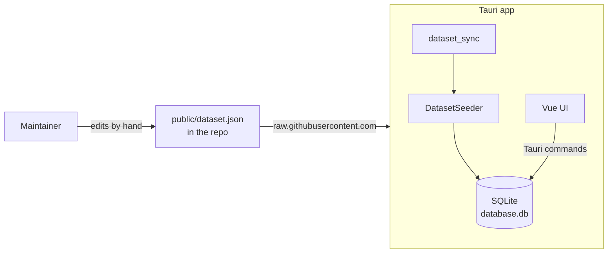
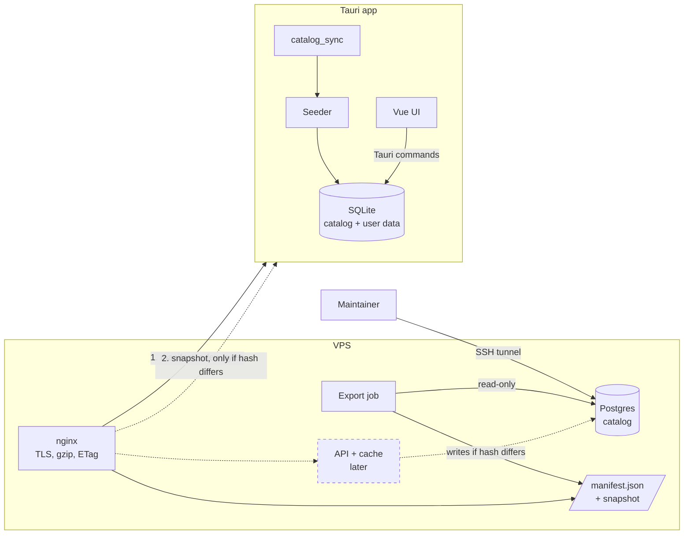

# 01 — Architecture

## Current state

- The catalog is a single JSON file (`public/dataset.json`, ~67 KB), validated by `dataset/dataset.schema.v1.json` and a Vitest test.
- At every startup the app downloads **the whole file**, compares its `version` field (semver) with the one stored in `dataset_metadata.json`, and re-runs the seeder if the remote version is higher.
- The local SQLite database (Diesel) holds both the catalog and the user data.
- Dataset URL per environment: `src-tauri/config/{dev,dev.android,prod}.json`.

A full description of the existing app is in [overview/existing-app.md](../overview/existing-app.md).

### Limits

| Problem | Consequence |
| --- | --- |
| Hand-editing a flat JSON file full of UUIDs | No referential integrity at entry time, easy mistakes, will not scale |
| Semver version bumped by hand | Forgetting it means apps never see the update |
| Full download at every startup | Wasted bandwidth, cost grows with the catalog |
| Blocking sync at startup (`Startup.vue`) | Without network, the user lands on an error screen |
| Version stored in a file separate from SQLite | Seeding and writing the version are not atomic |

## Target architecture

Three zones, each with a single responsibility:

| Zone | Role | Who accesses it |
| --- | --- | --- |
| **Postgres (VPS)** | Source of truth for the catalog, referential integrity | Maintainer (SSH tunnel), export job |
| **Static files (nginx)** | Read-only distribution of the catalog | Every app |
| **SQLite on the device** | Database read by the app + user data | The app only |

The app depends on neither Postgres nor an API for the catalog: nginx serves two files. If the database is stopped or under maintenance, apps keep syncing against the last published snapshot; if the whole VPS is down, they keep working on their SQLite database.

## Decisions

Structuring choices and their rejected alternatives are recorded in [decisions/](../decisions/README.md): hosting on a VPS ([0001](../decisions/0001-vps-over-managed-postgres.md)), static snapshot and hash ([0002](../decisions/0002-static-snapshot-and-hash.md)), offline-first SQLite ([0003](../decisions/0003-sqlite-offline-first.md)), local user data ([0004](../decisions/0004-local-user-data.md)), Docker Compose everywhere ([0005](../decisions/0005-docker-compose-everywhere.md)).

## Constraints

### Budget

The VPS is the only accepted paid item. Everything else (CI, off-site backups, certificates) must fit in free tiers.

### Operations

On a VPS, backups, security, certificates and monitoring are our responsibility. They are specified in [05-infrastructure-vps.md](05-infrastructure-vps.md) and are part of the scope, not a "later".

### Stable URL

The catalog URL is compiled into every published version of the app. It must remain valid for the whole life of those versions: see [05](05-infrastructure-vps.md#domain-name).

## Out of scope

- Backend API, user accounts, authentication, collection sync across devices.
- Application cache (Redis / Valkey).
- Catalog admin interface.

These topics are covered in [the roadmap](../roadmap.md#future-work) to check that the architecture does not block them. Image hosting is covered by [decisions/0010](../decisions/0010-relative-image-keys.md).
