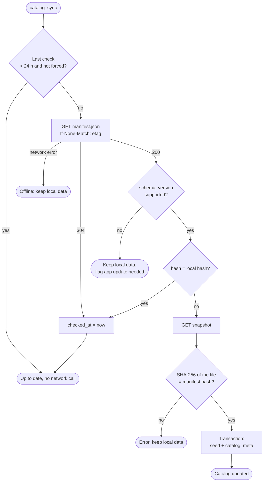

# 04 — App-side sync

Test scenarios: [tests/app-sync.md](../tests/app-sync.md).

## Principles

1. **The app always reads its SQLite database.** No screen depends on the network.
2. **Sync never blocks**, unless the local database is empty and no bundled snapshot is available.
3. **A check costs a few bytes**; the snapshot is downloaded only when its hash has changed.
4. **A failed sync changes nothing**: the database stays in its previous state.

## Local storage

The SQLite database keeps holding the catalog and the user data. A table replaces the `dataset_metadata.json` file:

```sql
CREATE TABLE catalog_meta (
  id              INTEGER PRIMARY KEY CHECK (id = 1),  -- single row
  hash            TEXT NOT NULL,
  schema_version  INTEGER NOT NULL,
  applied_at      TEXT NOT NULL,   -- when the snapshot was applied
  checked_at      TEXT NOT NULL,   -- last successful manifest check
  manifest_etag   TEXT,            -- for conditional requests
  base_url        TEXT             -- base URL received through relocated_to; NULL = URL from config
);
```

The hash is written **in the same transaction** as the seed: the database cannot hold a half-applied catalog with a hash claiming otherwise.

Foreign keys must be enforced on the SQLite connection (`PRAGMA foreign_keys = ON` when it is opened).

Migration from the existing app: if `dataset_metadata.json` exists, it is deleted and `catalog_meta` stays empty, which triggers a full sync at the next check.

## Algorithm



### Check frequency

| Situation | Behaviour |
| --- | --- |
| App startup, last check less than 24 h ago | No network call |
| App startup, last check more than 24 h ago | Manifest check in the background |
| "Sync" button in the settings | Immediate check (`force = true`), ignores the 24 h delay |

The delay (24 h) is a config constant. Combined with the `ETag`, the common "nothing changed" case costs one request per day with a body-less `304` answer.

`force = true` ignores the delay but **not** the hash comparison: if the hash is identical, nothing is downloaded. A separate `reseed` option re-applies the snapshot even with an identical hash, to repair a local database.

### Command result

`catalog_sync` returns a state rather than a boolean:

| State | Meaning | UI reaction |
| --- | --- | --- |
| `up_to_date` | Nothing to do | None |
| `updated` | New catalog applied | Toast + lists refreshed |
| `offline` | Manifest unreachable | None (silent), except for a manual sync |
| `app_update_required` | Remote `schema_version` not supported | "Update the app" banner |
| `error` | Invalid hash, unreadable snapshot, seed failure | Log; toast only for a manual sync |

## First launch

1. Empty database → the app applies the **snapshot bundled** in the binary (Tauri resource), with the hash from its bundled manifest.
2. It shows the home screen immediately.
3. A check of the remote manifest starts in the background; if a newer catalog exists, it is applied and lists refresh.

The app is therefore usable right after installation, even without network.

## Seeder

The seeder keeps its current strategy: upsert by `id`, and flagging `is_deleted = 1` on rows missing from the snapshot (never a physical delete, to preserve `user_copies` and favorites).

Changes:

- tables and columns follow the new schema ([06](06-database-schema.md));
- deserialization tolerates unknown fields;
- `catalog_meta` is written inside the transaction;
- the hash is verified before the JSON is parsed.

## Code changes

| File | Change |
| --- | --- |
| `src-tauri/config/*.json` | `dataset_url` → `catalog_base_url` (URL of the `catalog/` folder) |
| `src-tauri/src/services/dataset_service.rs` | `sync()` follows the algorithm above; semver comparison and `dataset_metadata.json` removed; a single download path for every platform |
| `src-tauri/src/db/seeder.rs` | See Seeder section |
| `src-tauri/migrations/` | New migrations: new schema, `catalog_meta` |
| `src-tauri/Cargo.toml` | Add `sha2`; remove `semver` |
| `src-tauri/tauri*.conf.json` | Bundled resources: snapshot + manifest |
| `src/screens/Startup.vue` | Sync no longer blocks navigation to the home screen |
| `src/stores/dataset.store.ts` | Handles the `catalog_sync` states |
| `src/screens/Setting.vue` | Manual sync button, date and short hash of the catalog |

### URL per environment

| Environment | `catalog_base_url` | Source |
| --- | --- | --- |
| desktop dev | `http://localhost:1420/catalog/` | `bun catalog:export` writes to `public/catalog/`, served by Vite |
| Android dev | Bundled snapshot only | The emulator cannot reach the machine's `localhost`; no remote check |
| prod | `https://<domain>/catalog/` | nginx on the VPS |

The app builds the manifest URL as `{catalog_base_url}v{SCHEMA_VERSION}/manifest.json`, where `SCHEMA_VERSION` is a constant compiled into the app.

### Catalog relocation

If the manifest contains `relocated_to`, the app stores that URL in `catalog_meta.base_url` and restarts the check against the new address. Only `https` URLs are accepted. Later checks use `base_url` in priority over the config.

## Edge cases

| Case | Expected behaviour |
| --- | --- |
| Network drops during the download | Error, database unchanged, retried at the next check |
| Corrupted or truncated snapshot | Hash mismatch → rejected, database unchanged |
| Manifest published but snapshot missing (404) | Error, database unchanged; should not happen (snapshot is published before the manifest) |
| App is closed during the seed | Transaction rolled back by SQLite, database unchanged |
| An item owned by the user is removed from the catalog | Row kept with `is_deleted = 1`, still visible in the collection |
| Catalog published as `v2`, app still on `v1` | The app keeps reading `v1/`, which is still published |
| The new URL (`relocated_to`) is unreachable | The app keeps its local catalog and retries; it does not fall back to the old URL until the new one has failed for 7 days |
