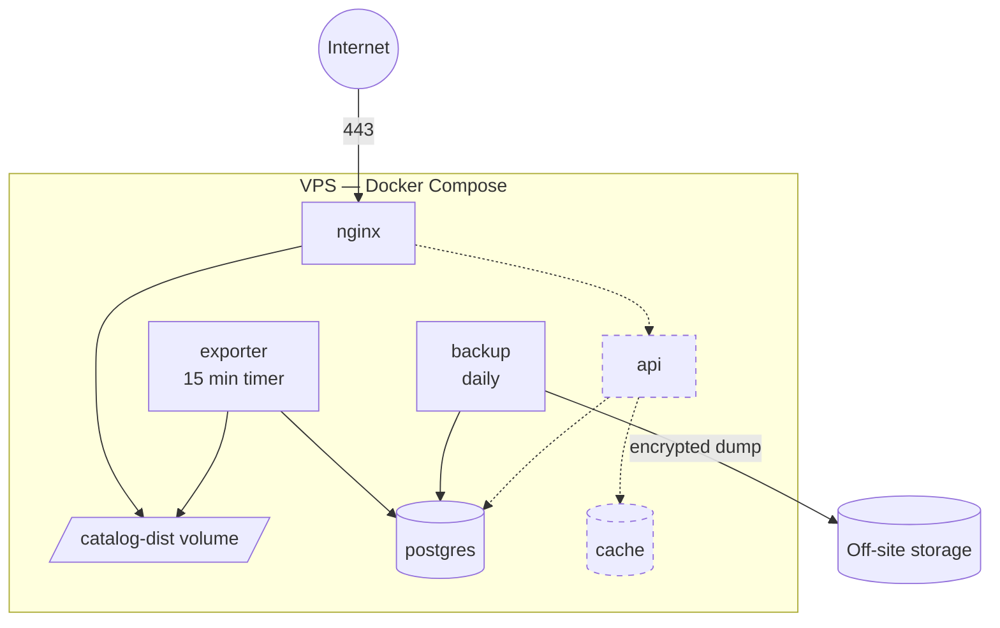

# 05 — VPS infrastructure

Test scenarios: [tests/infrastructure.md](../tests/infrastructure.md).

A single VPS (probably Hostinger) hosts the whole server side. This document describes what runs on it, how we deploy to it and what we have to operate ourselves.

## Services

| Service | Stage | Role | Exposed to the Internet |
| --- | --- | --- | --- |
| `nginx` | Phase 4 | TLS, catalog files, later proxy to the API | Yes (80 → redirect, 443) |
| `postgres` | Phase 4 | Catalog database, later user data | **No** |
| `exporter` | Phase 4 | Export job (see [03](03-catalog-export.md#export-job)) | No |
| `backup` | Phase 4 | Daily backup | No |
| `api` | Phase 5 | Accounts, user data sync | Through nginx only |
| `cache` | Phase 5, if measured useful | API cache | No |

Dashed services are not installed at first.

### Volumes

| Volume | Content | Backed up |
| --- | --- | --- |
| `pg-data` | Postgres data | Yes, by dump |
| `catalog-dist` | Manifest and snapshots | No: can be regenerated by an export |
| `certs` | TLS certificates | No: can be regenerated |

## Domain name

The catalog URL is compiled into every published version of the app: it must survive a change of server or host.

| Option | Advantage | Limit |
| --- | --- | --- |
| **Purchased domain** (recommended) | Changing server = changing a DNS record, without touching the apps | A few euros per year |
| Hostname provided by the host | Free | Tied to the VPS: losing it or changing plan breaks the URL |

Safety net in both cases: the `relocated_to` field of the manifest ([03](03-catalog-export.md#manifest), [04](04-app-sync.md#catalog-relocation)) can redirect apps as long as the old address still answers.

Planned subdomains: `catalog.<domain>` for catalog files, `api.<domain>` for the API.

## Deployment

Docker Compose, with the same files as locally plus `compose.prod.yml`.

GitHub Actions workflow `deploy.yml`, triggered manually or on `push` to `main` touching `infra/**` or `catalog/**`:

1. SSH connection to the VPS with a key dedicated to deployment.
2. Fetch the repo version to deploy.
3. **Backup** of the database if migrations are pending.
4. Apply migrations.
5. `docker compose up -d` (only restarts what changed).
6. Run an export.
7. Check: the public manifest answers `200` and its hash matches the snapshot.

If step 4 fails, the deployment stops: the services in place and the last published snapshot keep being served.

| GitHub secret | Use |
| --- | --- |
| `VPS_HOST`, `VPS_USER` | Deployment target |
| `VPS_SSH_KEY` | Private key of the deployment user |

Postgres passwords and the backup encryption key live in a `.env` on the VPS, not in GitHub.

## Security

| Topic | Rule |
| --- | --- |
| SSH | Key authentication only; no `root` login; separate deployment user |
| Firewall | Only ports 22, 80 and 443 are open |
| Postgres | No published port; reachable from the internal Docker network and through an SSH tunnel |
| TLS | Let's Encrypt certificates, automatic renewal |
| Updates | Automatic system security updates; Docker images pinned, updated deliberately |
| Login attempts | Automatic ban after repeated failures (fail2ban or equivalent) |
| nginx | Per-IP rate limiting; no directory listing |

## Backups

The VPS is a single point of failure: a backup that stays on it protects nothing.

| Topic | Rule |
| --- | --- |
| Frequency | Daily `pg_dump`, plus one before every migration |
| Destination | Off the VPS, encrypted (see Q6 in [the roadmap](../roadmap.md#open-questions)) |
| Retention | 7 daily, 4 weekly |
| Test | Restore on an empty database in phase 4, then at every Postgres major version change |

The catalog has an extra, free protection: the last published snapshot and the one bundled in the app both hold a full copy, re-importable with `catalog:import`.

### Full rebuild

Procedure to write and test in phase 4: on a fresh VPS, `git clone` → `.env` → `docker compose up` → restore the last dump → export. Target: under one hour, during which apps keep working on their SQLite database.

## Monitoring

| What | How |
| --- | --- |
| Manifest availability | Free external probe on the manifest URL |
| Export or backup failure | Notification (email or webhook) from the job |
| Disk space | Alert at 80 % |
| Backup freshness | Alert if the last one is older than 48 h |

## Adding the API (phase 5)

What this infrastructure already provides for:

- nginx is the single entry point: the API is added as a proxy target on `api.<domain>`.
- The catalog keeps being distributed as static files: the API only carries user data, which limits its load and Postgres's.
- The `catalog` schema is isolated: the API gets a read-only role on it and a write role on its own schema.
- The cache is only added if a measurement shows a need.
