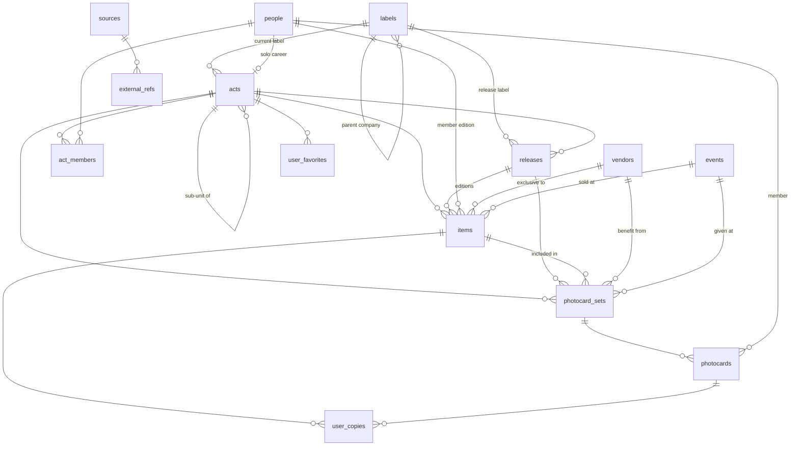

# 06 — New database schema

Test scenarios: [tests/database-schema.md](../tests/database-schema.md). Decisions: [0006](../decisions/0006-unified-acts.md) to [0011](../decisions/0011-catalog-data-sourcing.md).

Schema replacing the 14 current tables. It is written for Postgres (catalog, source of truth); the app's SQLite database mirrors it, with the type conversions described in [02](02-catalog-database.md#type-mapping).

## What changes, in short

| Before | After | Why |
| --- | --- | --- |
| Separate `groups` and `artists`, with a `group_id` / `artist_id` pair everywhere of which only one is set | One **`acts`** table (group, sub-unit or soloist) | Removes the "exactly one of the two" rule on 4 tables and the groups + artists `UNION`s in queries |
| `artists` = both a person and a solo career | **`people`** (the person) and an act of kind soloist | Lisa is a member of BLACKPINK *and* a solo artist: two roles, one person |
| Flat `agencies`, carried by the group | Hierarchical **`labels`**, also carried by each release | HYBE → BigHit Music; Lisa at YG then LLOUD |
| `albums`, `album_versions`, `digipacks`, `lightsticks`, `fanclub_kits`: 5 tables | **`releases`** (the work) + **`items`** (any physical object) | Fits season's greetings, photobooks, merch without a new table; a digipack becomes a format |
| `album_versions.format` mixes medium and release type | `releases.type` and `items.format` | A mini album on vinyl becomes describable |
| `photocards` attached to an album, a version or a digipack | **`photocard_sets`** + `photocards` | A card can come from an album, a lightstick, a pre-order, a concert, a pop-up |
| No notion of vendor or event | **`vendors`** and **`events`** | Target / Weverse exclusives, lucky draws, pop-up stores per country, concerts |
| Full `image_url` | Relative `image_key` | Change image host without a migration |
| `user_collection` with 6 foreign keys | **`user_copies`** with 2 foreign keys | One row per copy, with condition, price and note |
| Two favorites tables | **`user_favorites`** | A single target: `acts` |
| No trace of where a piece of data comes from | **`sources`** + `external_refs` + `review_status` | Required to feed the catalog from external sources |

## Overview



| Family | Tables | Where |
| --- | --- | --- |
| Reference | `labels`, `acts`, `people`, `act_members`, `vendors`, `events` | Postgres + SQLite |
| Objects | `releases`, `items`, `photocard_sets`, `photocards` | Postgres + SQLite |
| Provenance | `sources`, `external_refs` | Postgres only |
| User | `user_copies`, `user_favorites` | SQLite only (for now) |

## Reference tables

### `labels`

```sql
CREATE TABLE labels (
  id              uuid PRIMARY KEY,
  parent_label_id uuid REFERENCES labels (id),
  name            text NOT NULL,
  country         char(2) NOT NULL,          -- ISO 3166-1
  image_key       text
);
```

A null `parent_label_id` means a parent company or an independent label. The "agency" filter on the home screen can then target the parent company (all of HYBE) or the label.

### `acts`

Anything that releases albums and has fans: a group, a sub-unit, a soloist.

```sql
CREATE TABLE acts (
  id             uuid PRIMARY KEY,
  kind           text NOT NULL CHECK (kind IN ('group', 'unit', 'soloist')),
  parent_act_id  uuid REFERENCES acts (id),    -- group of a sub-unit
  person_id      uuid REFERENCES people (id),  -- the person behind a soloist
  label_id       uuid NOT NULL REFERENCES labels (id),  -- current label
  name           text NOT NULL,
  name_original  text,                         -- e.g. 에스파
  fandom_name    text,
  debut_date     date,
  disband_date   date,
  image_key      text,
  CHECK ((kind = 'unit') = (parent_act_id IS NOT NULL)),
  CHECK ((kind = 'soloist') = (person_id IS NOT NULL))
);
CREATE UNIQUE INDEX acts_soloist_person ON acts (person_id) WHERE person_id IS NOT NULL;
```

### `people` and `act_members`

```sql
CREATE TABLE people (
  id             uuid PRIMARY KEY,
  name           text NOT NULL,     -- common name shown by default
  real_name      text,
  name_original  text,              -- e.g. 지민
  birth_date     date,
  image_key      text
);

CREATE TABLE act_members (
  id          uuid PRIMARY KEY,
  act_id      uuid NOT NULL REFERENCES acts (id),
  person_id   uuid NOT NULL REFERENCES people (id),
  stage_name  text,                 -- stage name in this act, if different
  roles       text[] NOT NULL DEFAULT '{}',
  join_date   date,
  leave_date  date,                 -- null = current member
  CHECK (leave_date IS NULL OR join_date IS NULL OR leave_date >= join_date)
);
CREATE UNIQUE INDEX act_members_current ON act_members (act_id, person_id) WHERE leave_date IS NULL;
```

The `artist_aliases` table goes away: the in-group stage name goes to `act_members.stage_name`, the solo stage name is the `name` of the soloist act, the name in the original language goes to `name_original`. `act_members` having its own primary key allows a member to leave and come back.

### `vendors` and `events`

```sql
CREATE TABLE vendors (
  id       uuid PRIMARY KEY,
  name     text NOT NULL,           -- Weverse Shop, Soundwave, Target…
  kind     text NOT NULL CHECK (kind IN ('retailer', 'official_shop', 'platform', 'fanclub')),
  country  char(2)                  -- null = international
);

CREATE TABLE events (
  id          uuid PRIMARY KEY,
  act_id      uuid REFERENCES acts (id),
  name        text NOT NULL,
  kind        text NOT NULL CHECK (kind IN
                ('concert', 'popup_store', 'fansign', 'fanmeeting', 'broadcast', 'exhibition')),
  country     char(2),
  city        text,
  start_date  date,
  end_date    date
);
```

A tour is entered either as a single event, or as one event per city when the benefits differ from one city to the next.

## Object tables

### `releases`

The work, independently of its physical editions.

```sql
CREATE TABLE releases (
  id              uuid PRIMARY KEY,
  act_id          uuid NOT NULL REFERENCES acts (id),
  label_id        uuid NOT NULL REFERENCES labels (id),  -- label at release time
  title           text NOT NULL,
  title_original  text,
  type            text NOT NULL CHECK (type IN
                    ('full', 'mini', 'single', 'repackage', 'compilation', 'live', 'ost')),
  market          char(2) NOT NULL,   -- home market: KR, JP, US…
  release_date    date NOT NULL,
  image_key       text
);
```

A Japanese album is a `release` distinct from the Korean album (`market = 'JP'`), because it is a different work, not a regional edition.

### `items`

Any physical object one can own, except photocards.

```sql
CREATE TABLE items (
  id            uuid PRIMARY KEY,
  category      text NOT NULL CHECK (category IN
                  ('album', 'lightstick', 'fanclub_kit', 'seasons_greetings',
                   'photobook', 'video', 'merch')),
  act_id        uuid NOT NULL REFERENCES acts (id),
  release_id    uuid REFERENCES releases (id),   -- required for an album
  person_id     uuid REFERENCES people (id),     -- edition dedicated to a member
  vendor_id     uuid REFERENCES vendors (id),    -- store exclusive
  event_id      uuid REFERENCES events (id),     -- sold at an event
  name          text NOT NULL,                   -- e.g. "Box Set – Pink ver."
  format        text CHECK (format IN
                  ('photobook', 'digipack', 'jewel_case', 'platform', 'kit',
                   'vinyl', 'cassette', 'box_set', 'other')),
  region        char(2) NOT NULL DEFAULT 'XW',   -- XW = worldwide
  release_date  date,
  barcode       text,
  is_limited    boolean NOT NULL DEFAULT false,
  image_key     text,
  review_status text NOT NULL DEFAULT 'draft' CHECK (review_status IN ('draft', 'verified')),
  CHECK ((category = 'album') = (release_id IS NOT NULL)),
  CHECK (format IS NULL OR category = 'album')
);
CREATE INDEX items_act ON items (act_id, category);
CREATE INDEX items_release ON items (release_id) WHERE release_id IS NOT NULL;
CREATE INDEX items_barcode ON items (barcode) WHERE barcode IS NOT NULL;
```

- `region` follows ISO 3166-1, with `XW` for "worldwide" (same convention as MusicBrainz), replacing the current `GLOBAL` string. The "include exclusive items" setting filters on `region = 'XW' AND vendor_id IS NULL AND event_id IS NULL`.
- `barcode` is not unique: one code sometimes covers several versions sold at random.
- The former `album_versions` and `digipacks` tables become `items` of category `album`; a member digipack has `format = 'digipack'` and a `person_id`.

### `photocard_sets` and `photocards`

A **set** is a batch of cards distributed together: the cards of an album version, a store's pre-order benefit, the cards of a concert.

```sql
CREATE TABLE photocard_sets (
  id              uuid PRIMARY KEY,
  act_id          uuid NOT NULL REFERENCES acts (id),
  release_id      uuid REFERENCES releases (id),  -- related release, if any
  item_id         uuid REFERENCES items (id),     -- object that contains the cards
  vendor_id       uuid REFERENCES vendors (id),
  event_id        uuid REFERENCES events (id),
  kind            text NOT NULL CHECK (kind IN
                    ('inclusion', 'preorder_benefit', 'lucky_draw', 'event',
                     'broadcast', 'fanclub', 'other')),
  name            text NOT NULL,
  expected_count  integer CHECK (expected_count > 0),  -- known card count, even without visuals
  is_random       boolean NOT NULL DEFAULT true,
  region          char(2) NOT NULL DEFAULT 'XW',
  release_date    date,
  review_status   text NOT NULL DEFAULT 'draft' CHECK (review_status IN ('draft', 'verified')),
  CHECK (kind <> 'inclusion' OR item_id IS NOT NULL)
);

CREATE TABLE photocards (
  id         uuid PRIMARY KEY,
  set_id     uuid NOT NULL REFERENCES photocard_sets (id),
  person_id  uuid REFERENCES people (id),   -- null = group or unit card
  position   integer NOT NULL,              -- order within the set
  label      text,                          -- e.g. "selfie", "A", "concept"
  image_key  text,                          -- null = unknown visual
  UNIQUE (set_id, position)
);
CREATE INDEX photocards_person ON photocards (person_id) WHERE person_id IS NOT NULL;
```

**Known card, unknown visual**: the set carries `expected_count`. Until the cards are entered, the app shows "8 cards, visuals coming". `photocards` rows can also be created with a null `image_key`, which already lets the user tick "I have no. 3".

Cards "drawn at random, valid for every version" belong to a set that has a `release_id` and no `item_id`.

## User tables

In the app's SQLite database only, until the API exists.

```sql
CREATE TABLE user_copies (
  id              TEXT PRIMARY KEY NOT NULL,     -- UUID v7: stable creation order
  item_id         TEXT REFERENCES items (id),
  photocard_id    TEXT REFERENCES photocards (id),
  acquired_on     TEXT,                          -- date, optional
  condition       TEXT CHECK (condition IN ('sealed', 'opened', 'damaged')),
  price_amount    INTEGER,                       -- in minor units (cents)
  price_currency  TEXT,                          -- ISO 4217
  is_signed       INTEGER NOT NULL DEFAULT 0,
  notes           TEXT,
  created_at      TEXT NOT NULL,
  CHECK ((item_id IS NULL) <> (photocard_id IS NULL))
);

CREATE TABLE user_favorites (
  act_id      TEXT PRIMARY KEY NOT NULL REFERENCES acts (id),
  created_at  TEXT NOT NULL
);
```

The signature is now attached to a specific copy, no longer to "the first N". A wishlist would be added as a `user_wishlist` table of the same shape; it is not planned here.

## Provenance tables

To know where each piece of data comes from and to re-run an import without creating duplicates.

```sql
CREATE TABLE sources (
  id       uuid PRIMARY KEY,
  name     text NOT NULL UNIQUE,   -- musicbrainz, discogs, manual…
  license  text,
  url      text
);

CREATE TABLE external_refs (
  source_id    uuid NOT NULL REFERENCES sources (id),
  entity_type  text NOT NULL CHECK (entity_type IN
                 ('label', 'act', 'person', 'release', 'item', 'photocard_set', 'photocard')),
  entity_id    uuid NOT NULL,
  external_id  text NOT NULL,
  fetched_at   timestamptz NOT NULL DEFAULT now(),
  PRIMARY KEY (source_id, entity_type, external_id)
);
```

`review_status` (`draft` / `verified`) on `items` and `photocard_sets`: automatically imported data arrives as `draft` and **is exported to the apps only once verified**. These two tables and this column are not part of the snapshot.

Candidate sources and the import strategy are in [decisions/0011](../decisions/0011-catalog-data-sourcing.md).

## The schema against real cases

Facts quoted from memory: to be re-checked at entry time.

| Real case | Modeling |
| --- | --- |
| **HYBE** owns BigHit Music (BTS) and BELIFT LAB (ILLIT) | `labels`: HYBE with no parent; BigHit Music and BELIFT LAB with `parent_label_id` = HYBE |
| **Lisa**: *LALISA* (2021) at YG, *Alter Ego* (2025) at LLOUD | One `person` Lisa; one soloist `act` LISA (`label_id` = LLOUD); two `releases`, each with its own `label_id` |
| **Lisa** is also a member of BLACKPINK | One `act_members` row (BLACKPINK, Lisa); the same `person` |
| **3RACHA** (Bang Chan, Changbin, Han) within Stray Kids | `act` of kind `unit`, `parent_act_id` = Stray Kids, three `act_members` rows |
| **BORN PINK**: box set in 3 colors, KiT album, digipack in 4 member versions, limited vinyl | 1 `release`; 9 `items` of category `album`: 3 × `box_set`, 1 × `kit`, 4 × `digipack` with `person_id`, 1 × `vinyl` with `is_limited` |
| **Proof** (BTS): Standard, Compact, Collector's Edition | 1 `release` of type `compilation`; 3 `items` |
| **ARMY Bomb** ver. 1, 2, 3, Special Edition | 4 `items` of category `lightstick`, `act_id` = BTS |
| Fanclub membership kit, per generation | `items` of category `fanclub_kit` |
| **SKZOO** plushies, season's greetings | `items` of category `merch` / `seasons_greetings`, no new table |
| **Target-exclusive** version of an album | `item` with `vendor_id` = Target, `region` = `US` |
| **Japanese** album of a Korean group | Separate `release` with `market` = `JP`; limited editions A / B = `items` |
| Cards included in an album version | `photocard_set` of kind `inclusion` with `item_id`; one `photocard` per member and visual |
| **Weverse Shop** pre-order benefit | `photocard_set` of kind `preorder_benefit`, `release_id` + `vendor_id` |
| A store's **lucky draw**, visuals not known yet | `photocard_set` of kind `lucky_draw` with `expected_count`, no `photocards` rows |
| Cards from a **pop-up store in Tokyo** | `event` of kind `popup_store` (`country` = `JP`); `photocard_set` of kind `event` with `event_id` |
| Cards handed out at a **concert** | `event` of kind `concert`; `photocard_set` of kind `event` |
| Card slipped into a **lightstick** box | `photocard_set` of kind `inclusion` whose `item_id` is the lightstick |
| Group card (all members) | `photocards.person_id` is null |

## Impact on the app

| Topic | Effect |
| --- | --- |
| Home and collection lists | One query on `acts` instead of two merged in memory; pagination can happen in SQL |
| Group and Artist screens | A single "act" screen; `/groups/:id` and `/artists/:id` routes can merge |
| Counting owned / total | `items` by `act_id`, photocards through `photocard_sets.act_id`: no more per-type `UNION` |
| "Include photocards" setting | Include the `photocards` table in the count or not |
| `collection_agencies_view` view | Replaced by a `user_copies` → `items` → `acts` → `labels` join |
| Tauri commands | `group_*` and `artist_*` merge into `act_*`; `album_*` becomes `release_*` |
| Dataset and seeder | New snapshot format: `schema_version` starts at 1 with this schema, since no published app version reads the format of [03](03-catalog-export.md) yet |

Existing user data (collection, favorites) can be migrated: identifiers of current groups, artists, versions and photocards are kept as identifiers of the matching `acts`, `people`, `items` and `photocards`.

## Accepted trade-offs

| Choice | What we gain | What we accept |
| --- | --- | --- |
| One `items` table for every category | Extensible, a single foreign key on the collection side | Null columns depending on the category (`format`, `release_id`), held by `CHECK`s |
| Photocards outside `items` | Dedicated columns (set, position, member), simple separate count | Two foreign keys in `user_copies` instead of one |
| `acts` unifies groups and soloists | Simple queries and favorites | A soloist = two rows (`people` + `acts`) |
| Polymorphic `external_refs` | One table for every entity | No foreign key on `entity_id` |
| `review_status` on two tables only | Simple | An imported label or group is published without review |

## Open questions

| # | Question | Default proposal |
| --- | --- | --- |
| S1 | Album track lists (song titles)? | No: irrelevant for a collection of objects |
| S2 | Name translations (beyond the original name)? | Not for now: `name` + `name_original` are enough |
| S3 | Box content (poster, booklet, stickers)? | No: only photocards are tracked individually |
| S4 | Back side of photocards? | No: one `image_key` per card |
| S5 | Market value of cards? | No: out of scope, third-party data |
